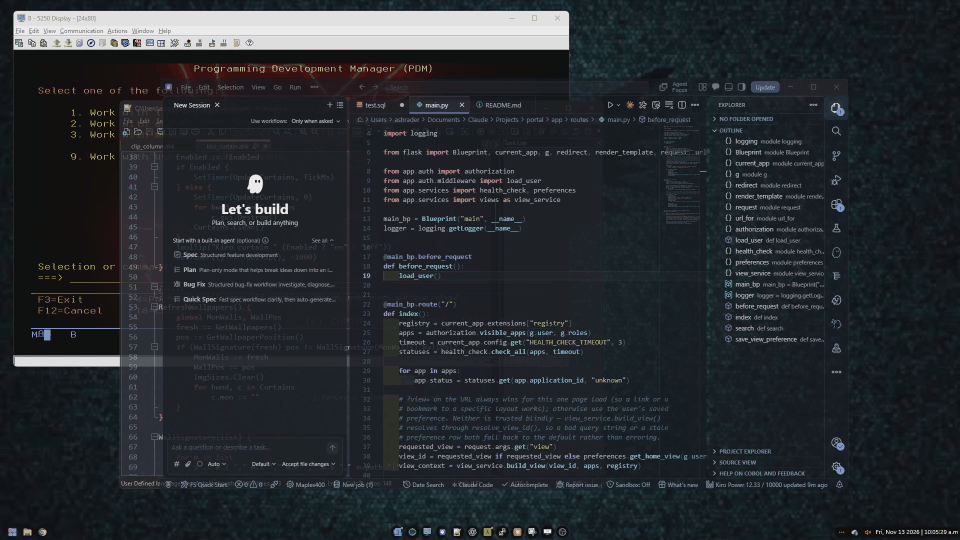
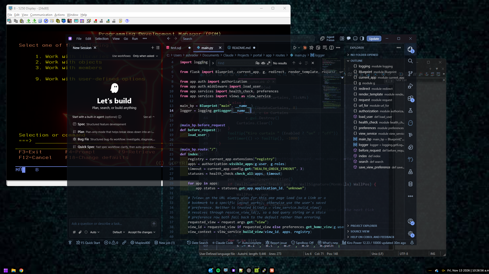
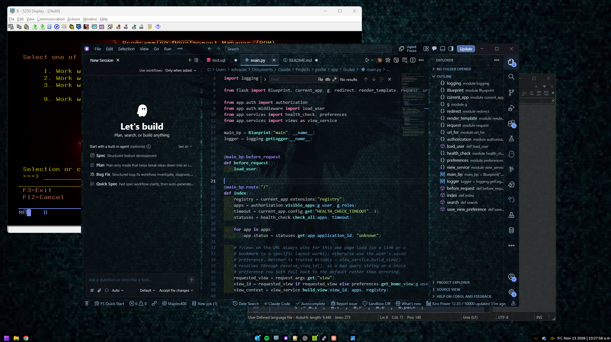

# Glass Curtain

Transparent editor themes look amazing until you open something behind the editor. Then your code is fighting a terminal, a spreadsheet, and three browser tabs for your attention.

**Glass Curtain** is a small AutoHotkey v2 script for Windows that keeps a "curtain" directly behind every VS Code / Kiro window. The curtain is sized to the window and shows the exact slice of your wallpaper that would normally be there. Through the transparency it looks like the real desktop, but whatever apps are behind the editor stay hidden.

## Demo

Glass Curtain hides background applications while preserving
the appearance of a transparent editor.

### Before and after

| Curtain OFF | Curtain ON |
|---|---|
|  |  |

Built to go with transparent themes like [Lynx Theme Pro](https://github.com/bastndev/Lynx-Theme-Pro).

## Features

- **Follows every window.** Main window, popped-out editor windows, maximized or not. Each one gets its own curtain that moves and resizes with it.
- **Multi-monitor aware.** Reads each monitor's wallpaper straight from Windows, so different wallpapers on different screens just work.
- **Picks up wallpaper changes automatically.** Change your wallpaper and the curtains update within a couple of seconds. Honors Fill, Fit, Stretch, and Center.
- **Stays out of the way.** No taskbar or Alt+Tab entry, never takes focus, and hides itself when the editor is minimized.
- **Toggle on demand.** `Ctrl+Alt+W` turns it on and off for when you actually want to see through the glass.
- **Tile and Span wallpaper modes.** These are currently approximated using Fill positioning.

## Requirements

- Windows 10 or 11
- [AutoHotkey v2](https://www.autohotkey.com/)
- A transparent editor theme (otherwise there's nothing to see through)

## Installation

1. Install AutoHotkey v2.
2. Download `glass_curtain.ahk`.
3. Open it in a text editor and check `TargetExe` (see Configuration).
4. Double-click the script to run it.

To start it automatically with Windows, press `Win+R`, type `shell:startup`, and put a shortcut to the script in that folder.

## Configuration

Settings are at the top of the script:

| Setting | Default | What it does |
|---|---|---|
| `TargetExe` | `"Kiro.exe"` | The editor's process name. Use `"Code.exe"` for VS Code. Check Task Manager → Details if unsure. |
| `CurtainColor` | `"0a0e14"` | Fallback color if a wallpaper can't be read. |
| `ToggleKey` | `"^!w"` | Hotkey to toggle the curtain (`Ctrl+Alt+W`). |
| `TickMs` | `16` | Target synchronization interval: 16 ms is approximately 60 updates per second. |
| `WallCheckMs` | `2000` | How often (ms) to check for wallpaper changes. |

## How it works

Every tick, the script finds the editor's top-level windows and keeps a borderless, non-activating window directly underneath each one in the Z-order, matching its visible bounds. The wallpaper for each monitor comes from Windows' `IDesktopWallpaper` API, scaled to match your wallpaper layout and offset so the visible slice lines up with the real desktop.

## Known limitations

- **Dynamic wallpapers.** Windows Spotlight and slideshow behavior depends on whether Windows exposes a readable wallpaper image. If it doesn't, the curtain uses the configured fallback color.
- **Brief catch-up flash.** When switching back to the editor, its curtain may take a moment to catch up depending on Windows scheduling and system load.
- **Mixed display scaling.** If one monitor uses a different scaling percentage, its wallpaper slice may be slightly offset.
- **Windows spanning multiple monitors.** Each editor window uses the wallpaper of the monitor containing its center. Windows spanning monitors with different wallpapers may show an incorrect background on one side.

## Troubleshooting

**Nothing happens when I run the script**
- Confirm AutoHotkey v2 is installed.
- Check that `TargetExe` matches your editor's process name.
- Make sure your editor is using a transparent theme.

**The wallpaper doesn't line up**
- Check your Windows wallpaper positioning mode.
- Mixed-DPI configurations and windows spanning multiple
  monitors may produce alignment differences.

**I want to disable the effect**
- Press `Ctrl+Alt+W` to toggle the curtains.
- Exit the script from the AutoHotkey tray icon to stop it.

## License

[MIT](LICENSE)